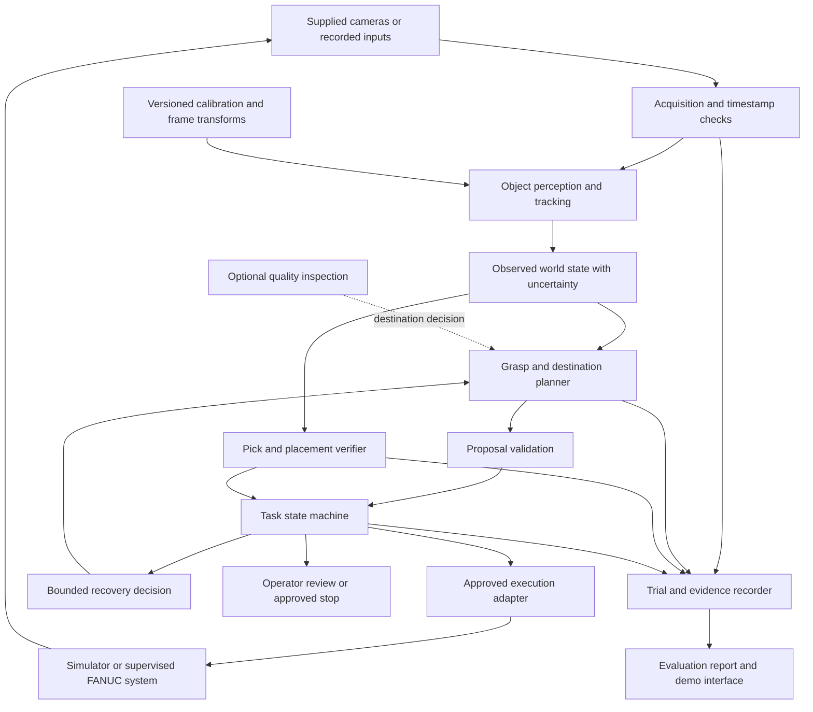
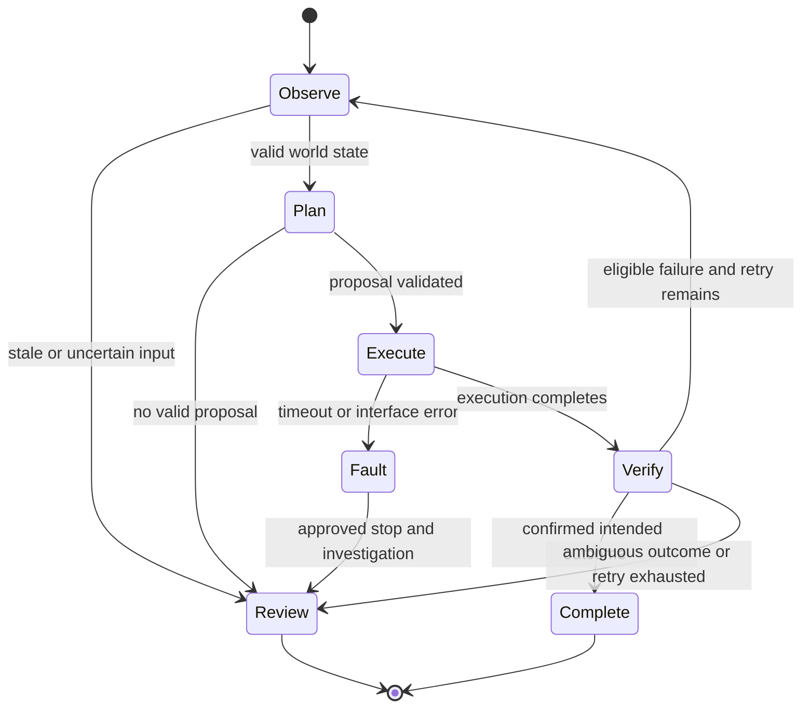

> Historical planning/research document. For current scope, resource status, verified results and next steps, read [START-HERE.md](START-HERE.md). Statements below describe an earlier project stage.

# Team V: Adaptive Robotic Sorting with Verified Grasping and Recovery

Project specification and architecture · October 9, 2026

Status: proposed implementation, not a claim of working robot software. Dataset 3 is the core. Hardware interfaces, robot assets, compute allocation, and physical sessions are unconfirmed. The team-plan form is prepared but must not be submitted without the user's explicit authorization.

## 1. What we must build

Build a vision-guided system for the supplied FANUC robot that can pick approved objects from changing positions, place them in the intended destination, verify the outcome, and recover from a failed pick within a limited retry budget.

The contribution is the complete feedback loop, demonstrated with measurements on the real system. A scripted successful pick or an attractive simulated video is insufficient evidence. We must show what changes when vision, verification, and recovery are added to the approved baseline.

The central question is:

> Can feedback from the supplied cameras reduce incomplete sorting tasks and operator intervention when approved object positions vary?

This is an ambitious but bounded four-week project. We are not promising a general-purpose robot, arbitrary-object manipulation, or a new foundation model. The initial operating domain is the existing CSI objects, fingers, workspace, and supervisor-approved variations.

### Required result

- Reproducible baseline in the supplied robot twin.
- Camera-based object localization with explicit coordinate frames and uncertainty checks.
- A grasp and placement proposal validated against approved workspace constraints.
- Execution through the interface approved by CSI and the assigned mentor.
- Observation-based verification of pick and placement outcomes.
- Limited recovery after an eligible failure, followed by a clear request for operator intervention when necessary.
- Matched baseline and proposed-system evaluations, including every attempt and failure.
- A supervised physical demonstration, trial logs, approximately five-minute video, one-page summary, repository, and references.

### Conditional extension

Dataset 1 can add quality-directed sorting: inspection assigns an approved object to an acceptable, rejected, or review destination. Implement this only after the robotics core works and organizers confirm object, camera, and gripper compatibility.

The FANUC cell is separate from the vial production line. The supplied tray-camera model must not be assumed to work from the FANUC cameras. A demonstration with representative inspection objects must be described as such. Do not claim production-line integration unless it actually exists and has been approved and tested.

## 2. Scope and success contract

Start with one approved object family, the existing fingers, fixed camera mounts, and a small set of approved destinations. Vary starting position first, then orientation. Add clutter or new object types only after reliability is established.

An **attempt** is one physical or simulated pick-and-place attempt with an explicit outcome. A **task** is the intended transfer of one identified object to one destination; it may include approved retries. An **episode** is a recorded run containing one or more tasks. A task is successful only when the intended object reaches the intended destination and verification supports that conclusion.

Distinguish these outcomes:

| Outcome | Meaning | Response |
| --- | --- | --- |
| Confirmed success | Evidence supports the intended pick and placement | Complete task and log evidence |
| Confirmed eligible failure | Object remains available and an approved recovery is possible | Re-observe and propose a bounded retry |
| Uncertain outcome | Cameras cannot reliably establish success or failure | Request operator review; avoid a blind retry |
| Interface fault | Timeout, stale state, unavailable camera, or execution error | Stop scheduling actions and follow the approved stop procedure |
| Constraint failure | Proposed target or path is outside approved limits | Reject proposal and request review |

The software's validation checks supplement the industrial system's protections. They are not a safety-rated controller, an emergency stop, or a replacement for the supervisor.

### Provisional performance goals

Choose numeric acceptance thresholds with the mentor after measuring the baseline. Before that, commit to evidence rather than invented success percentages:

1. No task is reported successful without verification evidence.
2. Every attempted action is represented in the logs.
3. Retry count is bounded and configurable; an illustrative development value is one retry, subject to mentor approval.
4. Invalid, stale, or uncertain inputs do not produce new physical execution requests.
5. The proposed system improves completed tasks or interventions over baseline under matched conditions, with cycle-time costs reported.

## 3. System architecture



Use a single orchestrator to own each task's lifecycle. Perception, planning, execution, and verification communicate through explicit typed records. A demo interface displays these records; it must not independently trigger robot commands.

There are three execution modes:

| Mode | Inputs | Execution | What it establishes |
| --- | --- | --- | --- |
| Replay | Recorded inputs and supplied observations | No physical action | Data flow, state transitions, verification logic, logging |
| Simulation | Twin camera outputs and simulated state | Simulator adapter | Scene-specific behavior and controlled experiments |
| Supervised physical | Approved real camera and controller inputs | Mentor-approved adapter | Performance on the actual setup |

Replay and simulation results must remain clearly separated from physical results. A mock outcome never counts as a robot success.

## 4. Component responsibilities

### 4.1 Acquisition

Read camera frames through the supplied supported interface. Store camera identifiers, capture timestamps, receipt timestamps, dimensions, and a reference to the original frame. Establish whether cameras are synchronized; do not assume equal timestamps imply the same physical event.

Reject frames older than a configured maximum age. Record dropped or unavailable views. Use the smallest camera set that supports reliable localization and verification; adding views should address a measured failure.

### 4.2 Calibration and geometry

Maintain camera intrinsics, distortion models, extrinsics, robot-to-camera transforms, workspace boundaries, and destination geometry as versioned configuration. Every pose includes a frame name and units. Do not silently mix pixel coordinates with robot coordinates or millimeters with meters.

Pending organizer confirmation: camera depth availability, supported coordinate conventions, calibration format, object geometry, controller reference frames, and transform accuracy. If cameras provide RGB only, begin with an approved planar localization method and known object geometry rather than assume a depth sensor exists.

Before physical execution, verify coordinate mapping with the supervisor using approved reference points. A successful simulated transform does not prove the real calibration is correct.

### 4.3 Perception and world state

The first perception baseline should solve the actual approved object task with minimal complexity. Candidate methods include geometric/color segmentation for simple blocks or a lightweight detector trained with synthetic examples. Select after inspecting the real samples and twin.

Output object candidates, localization estimates, visibility/occlusion information, and confidence or uncertainty. Detection confidence is not automatically calibrated probability. Include reasons for rejecting observations.

Tracking must handle an object disappearing into the gripper, reappearing, or becoming occluded without treating it as a new successful placement. Maintain a stable task object identity when evidence permits; otherwise request review.

### 4.4 Grasp and destination planning

Start with a small library of mentor-approved grasp templates compatible with the existing fingers. Select a candidate using object geometry, estimated pose, clearance, uncertainty, and task destination. Do not introduce learned grasp policies until a baseline failure justifies them.

A proposal includes the target object, grasp reference, destination, required transforms, and reasons for selection. Motion generation and collision checking must use the supported simulator/controller workflow; implementation depends on the released assets and robot interface.

Do not assume that installing the official FANUC ROS 2 driver provides permission or compatibility with CSI's controller. ROS 2 is a candidate integration route, not a confirmed requirement.

### 4.5 Proposal validation

Before sending a new execution request, check that observation and robot state are fresh, frame transforms exist, units are explicit, the object is sufficiently observed, the destination is approved, the retry limit is respected, and the supported planner/controller has accepted the motion proposal.

Reject proposals on missing information. Store the reason so reviewers can distinguish perception failures, planning failures, and conservative abstentions.

### 4.6 Execution adapters

Define one application-facing contract implemented by replay, simulation, and physical adapters. Only the physical adapter can submit real actions, and only within an approved supervised session.

Required behavior: unique command identifiers, acknowledgement, bounded completion timeout, explicit success/error states, and a documented approved stop procedure. After a timeout, do not resend blindly: determine whether an action executed before issuing another request.

A dry-run mode validates and logs a proposal without sending it. Physical mode should require deliberate session configuration and confirmed interface availability, not activate automatically when a simulator is absent.

### 4.7 Outcome verification

Verify both stages:

- **Pick:** evidence that the intended object left its source and is in the expected manipulated state, using available cameras and approved gripper/controller signals.
- **Placement:** evidence that the intended object is in the intended destination and no unresolved ambiguity remains.

Use before/after observations with timing and identity context. Absence from the source alone does not prove a successful pick: the object could have moved, fallen, or become occluded. Destination occupancy alone does not prove correct placement if another object was already present.

Treat uncertain outcomes separately from confirmed failures. Begin with interpretable rules; use a learned verifier only if the data and evaluation support it.

### 4.8 Recovery

Recovery uses fresh observations rather than repeating the same failed command. For an eligible failed grasp, re-localize the object and choose an alternative approved grasp/template when possible. A misplaced, missing, dropped, or ambiguously located object may require operator review rather than autonomous recovery.

Track retries per task. Stop after the configured limit or any fault. Log whether recovery restored task completion and its cycle-time cost.

### 4.9 Optional quality inspection

Train inspection using synthetic images from the appropriate twin. Baselines may include a lightweight classifier or reference comparison; TAO Visual ChangeNet is an option, not a requirement. Reserve untouched real examples for final evaluation and clarify permitted real-data calibration, threshold tuning, and prompt examples with organizers.

For Dataset 1, preserve the target aperture identity and fixture position. Distinguish an empty expected placement from a trailing position that has not yet been filled. Report missed defects and false alarms separately. A low-confidence classification routes to review only if the supervisor approves that behavior and destination.

A vision-language model may help offline diagnosis or provide an evaluated auxiliary baseline. It must not become an unvalidated source of arbitrary robot commands.

## 5. Data contracts

These are proposed application contracts, not descriptions of the unreleased controller API.

| Record | Required content |
| --- | --- |
| FrameObservation | Camera ID, capture/receipt times, image reference, dimensions, calibration version, validity |
| ObjectEstimate | Object ID/class, pose or localization, frame, units, uncertainty, visibility, observation IDs |
| WorldState | Objects, destinations, robot state reference, timestamp, unresolved ambiguities |
| ActionProposal | Task/attempt IDs, object, grasp template, destination, frame/units, validation evidence |
| ExecutionResult | Command ID, acknowledgement, start/end times, adapter mode, completion/fault state |
| VerificationResult | Pick/placement verdicts, evidence references, uncertainty, reason codes |
| TrialRecord | Condition/split, code/model/config versions, attempts, outcomes, elapsed times, interventions |

Do not expose untyped controller-specific dictionaries throughout the system. Translate at the adapter boundary. Keep calibration and configuration versions with every trial so behavior can be reproduced.

## 6. Task state machine



Every transition has a logged reason. An operator intervention ends or explicitly resets the task according to the evaluation protocol; it must not disappear from reported results.

## 7. Repository structure

Recommended implementation layout; most modules below do not exist yet:

```text
src/team_v/
  contracts.py
  acquisition/
  calibration/
  perception/
  planning/
  execution/        # replay, simulation, approved physical adapter
  verification/
  recovery/
  orchestration/
  evaluation/
configs/           # example settings; no secrets
scenarios/         # small replay fixtures and trial manifests
tests/             # meaningful state, adapter, and metric checks
scripts/           # audit, replay, evaluation entry points
docs/
data/              # access instructions and trial-log template
```

Use Python for the initial orchestration/evaluation implementation, subject to compatibility with the supplied runtime. Pin dependencies after testing in that environment. Keep large datasets, generated batches, checkpoints, and credentials out of Git. Preserve raw data unchanged and document how authorized teammates obtain it.

Existing starting materials include the dataset audit script, findings, resource inventory, team-plan draft, and trial-log CSV header. They are preparation artifacts, not a robotics implementation.

## 8. Evaluation design

### Comparisons

| Variant | Purpose |
| --- | --- |
| Approved existing baseline | Establish current behavior |
| Vision-guided planning | Isolate gains from localization/adaptation |
| Vision plus verification | Measure detected failures and abstentions |
| Vision, verification, and recovery | Measure completed-task gains and retry cost |
| Optional inspection extension | Evaluate quality routing independently of grasp reliability |

Match conditions across variants where feasible. Use the same approved object families and arrangement distribution. Randomize trial order where practical to reduce learning/time effects. Record any conditions that cannot be reproduced.

### Metrics

- First-attempt pick success = successful first picks / tasks started.
- Attempt-level pick success = successful picks / pick attempts.
- Correct placement = verified intended placements / placement attempts, with the denominator stated.
- Full-task success = verified completed tasks / tasks started.
- Recovery success = tasks completed after an eligible initial failure / eligible failures where recovery was attempted.
- Recovery coverage = failures eligible for recovery / initial failures.
- Intervention rate = tasks requiring operator intervention / tasks started.
- Cycle time: median and upper-tail duration, plus time spent on failed tasks and retries.
- Perception/planning/verification latency, frame age, and fault counts.
- If inspection is included: defect misses, false alarms, review rate, per-class results, and quality-routing accuracy.

Always show counts alongside percentages. Report insufficient samples honestly; small physical trials cannot establish production reliability. Confidence intervals are useful, but repeated trials of the same object/arrangement are correlated and must not be treated as independent evidence without qualification.

### Splits and trial counts

Define development, pilot, and final manifests before the final evaluation. Keep final arrangements and examples out of tuning. A provisional simulation target is at least 100 tasks per principal variant across varied arrangements; revise after runtime benchmarking. Physical trial counts must be agreed with CSI according to available supervised time. Do not promise a count before a booking is confirmed.

Freeze code, models, transforms, and configuration before final testing. Archive all attempts, inputs, evidence, and interventions. A highlight reel is supplementary to the complete report.

### Software verification before hardware

Test stale input rejection, transform/unit errors, retry exhaustion, ambiguous outcome handling, controller timeout without duplicate execution, and metric denominators. Use deliberately constructed replay scenarios for these checks. These tests establish software behavior only; calibration, collision behavior, gripper compatibility, and physical accuracy require simulator and supervised hardware validation.

## 9. Synthetic data and model strategy

Begin with a simple approved-object perception baseline. Inspect the robot twin before selecting training methods. Confirm whether it supports actual articulation, contact, gripper motion, object physics, and camera rendering; a static visual twin is not automatically a policy-training environment.

Generate controlled variations of object pose, lighting, materials, and approved camera conditions. Export labels and generation configuration with each batch. Change one source of variation at a time and evaluate on held-out real data only within the permitted rules.

Do not use the downloaded vial-line twin as a substitute for the FANUC scene. The vial assets inspected so far contain static geometry and recorded animation; they do not establish robot policy or fluid-process simulation capabilities.

Learned policies and Isaac Lab are stretch options. Require a specific baseline failure, a credible training environment, a compute estimate, and an evaluation comparison before committing to them.

## 10. Compute and coding-agent requests

Current proposed Brev request: up to $600 equivalent, estimated as 120 L40S simulation/rendering hours at the guide's approximately $3/hour, 40 lightweight training/inference hours at approximately $2/hour, and $160 contingency/storage. Confirm console rates and benchmark before scaling. Stop instances between sessions; preserve important results outside instance disks.

Request early access to MSOE GB10/Rosie and UWM Spark as alternatives. CSI workstation access is conditional on approved twin work and reservations. Requested access is not guaranteed availability.

Current user-directed subscription request for one month:

- Eight ChatGPT Pro seats at $100 each: $800, including Codex; organizers must confirm Astra availability and limits.
- Eight Claude seats at the event guide's $20 tier: $160, subject to availability.
- Preferred subscription total: $960.
- Final fallback: eight $20 ChatGPT Plus seats plus eight $20 Claude seats, total $320. Astra access is not assumed in this fallback.

Subscriptions are separate from Brev and from separately billed API usage. Model choice does not itself increase robot-simulation GPU hours. Do not purchase or activate paid resources merely because they appear in this draft. Existing subscriptions and sponsor eligibility must be checked before provisioning.

## 11. Team organization

Eight confirmed teammates: Aditya Miriyala, Venkata Reddy Karri, Shritej Gunda, Koushik Cherukuri, Thanvi Gorrepati, Khushal Lingamaneni, Levi Eloy Santos, and Yuktha Koganti. Liam Salas is not a participant on this team. The event dashboard team is Venkata Reddy Karri's Team; the user confirmed its roster. A duplicate Aditya entry was observed and should be clarified without creating a second submission.

| Pair | Responsibility | First deliverable |
| --- | --- | --- |
| A | Simulation and synthetic data | Twin capability audit and reproducible baseline scene |
| B | Perception and evaluation | Object estimates, uncertainty, fixed trial manifests |
| C | Planning, verification, recovery | Replay state machine with bounded retries and explicit outcomes |
| D | Integration, testbed coordination, presentation | End-to-end replay, complete logs, physical test request |

Assign names based on actual skills and weekly availability. Select one integration owner and one testbed coordinator. Agree on contracts before parallel implementation. Each pair contributes to a shared executable demonstration, not an isolated notebook.

## 12. Delivery milestones and gates

| Target | Deliverable | Gate |
| --- | --- | --- |
| October 9–14 | Local replay, metrics contract, team roles, reviewed plan, asset/access requests | Form reviewed; interfaces/dependencies documented |
| October 15–18 | Existing-object simulated baseline | Scene capabilities and transforms verified |
| October 19–23 | Vision, verification, recovery; early physical pilot | Repeatable integrated behavior and supervised feedback |
| October 24–26 | Approved variations; optional inspection | Core reliability maintained and extension feasible |
| October 27–29 | Frozen final supervised evaluation | Complete attempt logs and separated final conditions |
| October 30–November 1 | Video, summary, repository, references | Claims match measured evidence |
| November 5 | Finals demonstration/presentation | Tested release and recorded fallback available |

Dates are targets, not confirmed testbed appointments. If robot assets or hardware access remain uncertain by the plan deadline, resolve scope with organizers. Preserve the Dataset 3 objective while avoiding an unsupported physical integration promise.

## 13. Demonstration architecture

Show one compact interface containing camera inputs, object estimates, current task state, intended destination, verification evidence, retry count, and live/replay mode. Present the baseline and proposed system under comparable conditions. Keep infrastructure details out of the operator flow unless they affect a decision.

Suggested five-minute story:

1. Manufacturer problem and approved operating domain.
2. Baseline behavior under a position variation or failed grasp.
3. Proposed system observes, plans, verifies, and recovers.
4. Measured results, sample counts, cycle-time tradeoff, and failures.
5. Business applicability, limitations, and next validation step.

Prepare a recorded demonstration from the tested release in case live hardware is unavailable at finals. Clearly label recorded and simulated footage.

## 14. Risks and decisions still open

| Dependency or risk | Required decision/action |
| --- | --- |
| FANUC package absent at last check | Obtain assets, supported versions, and capability confirmation |
| Unknown physical command interface | Confirm with CSI/mentor before choosing integration stack |
| Camera depth/calibration unknown | Select localization method after examining actual inputs |
| Unconfirmed visits | Request initial observation and one or two supervised tests early |
| Inspection compatibility uncertain | Keep extension conditional; do not block core robotics |
| Real-data training boundary | Obtain explicit guidance on calibration/tuning/prompt use |
| Compute/subscription funding uncertain | Benchmark and keep a workable smaller-resource path |
| Team skills/time unassigned | Name pair owners, integration owner, and coordinator |
| Shared form persistence uncertain | Keep exact current fields backed up before browser changes |

The form remains unsubmitted by explicit user instruction. Its current fields and checkbox selections were backed up in Apple Notes under “Team V — Team Plan Form Backup — October 8, 2026.” The selected “build.nvidia.com only” option conflicts semantically with other compute choices; resolve that wording with the user before final submission rather than silently interpret it as exclusive API use.

## 15. Immediate next implementation

Build the replay runner first:

1. Read a small scenario manifest with recorded/mock observations and expected outcomes.
2. Validate timestamps, frame identifiers, and required inputs.
3. Produce a proposal without physical execution.
4. Consume a supplied execution/verification observation.
5. Transition to completion, bounded retry, fault, or review.
6. Export a complete task/attempt log and metric summary.

Include scenarios for a successful transfer, failed pick followed by successful retry, exhausted retry, occluded/uncertain outcome, stale camera input, and ambiguous controller timeout. These are software fixtures, not competition test results. Once the twin arrives, replace the replay execution boundary with the simulator adapter while preserving the same records and metrics.

## 16. Sources and evidence boundary

Competition pages last inspected October 8, 2026. Pending items reflect that check, not a guaranteed current release status. Recheck before implementation choices or submission.

- [Competition overview](https://msoe-maic.com/library?article=Rockwell-NVIDIA-Fall-2026)
- [Dataset 3: Grasping and Sorting](https://msoe-maic.com/library?article=Rockwell-NVIDIA-Fall-2026-Grasping-Sorting)
- [Dataset 1: Final Vial Inspection](https://msoe-maic.com/library?article=Rockwell-NVIDIA-Fall-2026-Vial-Inspection)
- [Data collection and supervised testing](https://msoe-maic.com/library?article=Rockwell-NVIDIA-Fall-2026-Data-Collection)
- [Compute guide](https://msoe-maic.com/library?article=Rockwell-NVIDIA-Fall-2026-Compute)
- [Tools and resources](https://msoe-maic.com/library?article=Rockwell-NVIDIA-Fall-2026-Resources)
- [Official OpenAI subscription guidance](https://learn.chatgpt.com/docs/pricing)

Architecture, trial targets, ownership structure, and proposed methods are Team V design recommendations. Hardware provisions and event requirements come from the linked guides. No model training, Isaac simulation run, or physical robot test has yet been established by the work documented here.
