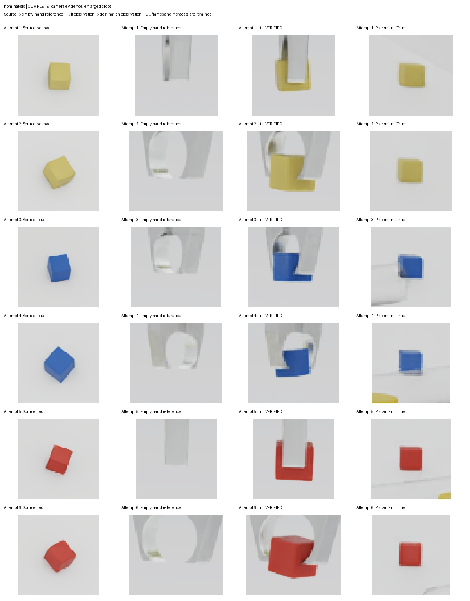

# Camera-supervised flat-slot kitting pilot

This is a separate simulation extension. The original six-cube stacking starter and its confidence, opening, geometry and motion checks remain unchanged. This extension uses the existing HSV proposals and full-yaw image silhouette fitting, accepting source poses only at IoU >=0.85.

The runtime observes again before every pick, rejects changed/stale targets, performs FK/IK preflight over the complete pick/place path, and executes one pick. It compares live side/wrist RGB with same-pose empty-hand references, requires positive held-part evidence plus source disappearance, then places into a flat slot. Completion needs two fresh table observations and positive side-camera destination evidence. Source disappearance alone never verifies a pickup.

A confirmed empty grasp permits one retreat/re-observe retry. Wrong-colour, uncertain pickup, uncertain placement, lost previous placement, inconsistent versions, missing/repeated/skewed frames, robot motion during observation, IK failure or exhausted retry holds the simulation. Missing inventory yields a bounded WAIT_FOR_PART state. The controller never uses simulator object names/poses to supply targets or verify runtime success; the separate harness reads object state only for fixture setup, fault injection and post-run scoring.

## Files

- supervisor.py: camera observation contracts, inventory/target/outcome gates.
- vision.py: image-only geometric detection and projected-volume colour evidence.
- sim_plant.py: existing robot FK/IK and physical articulation, camera capture and joint feedback.
- trial_harness.py: initial fixtures, fault injection and independent simulator scoring.
- runner.py: state transitions and all-attempt reporting.
- test_supervisor.py: stale, missing, moved, ambiguous and outcome regression tests.
- pilot_on_rosie.sh: bounded single-cube T4 pilot (optional colour argument).
- scenarios_on_rosie.sh: selected or full scenario suite, one GPU and fresh directories.
- summarize_trials.py: report acceptance summary with explicit prior-suite provenance.
- test_vision_geometry.py: pixel geometry and unchanged colour/occlusion rejection gates; requires FANUC_STARTER and the existing OpenCV environment.

## Run

Use Rosie team-v-isaac/bin/python with Isaac 6.0.0.0; do not use a plain host interpreter for the simulation.

```bash
python -m unittest -v test_supervisor
python runner.py --starter "$HOME/team-v-starter/fanuc_er4ia_sim" \
  --out "$HOME/team-v-runs/dynamic-new-trial" --scenario nominal --colours blue
```

Omit --colours for a six-part yellow/yellow/blue/blue/red/red flat kit. Always use a fresh output directory. Other scenarios: empty, missing (red absent), moved (25 mm target displacement between proposal and precheck), miss_once/miss_twice (injected jaw-close command failure), stale (delayed-observation rejection). For missing use --colours red; for one-cube motion/fault trials use --colours blue.

Read execution_report.json, the event sequence, saved RGB/camera/observation JSONs and independent simulator_score. Exit status alone is insufficient because Kit can swallow exceptions. A task is successful only when task_complete is true, all intended slots are camera-verified, and the independent truth score agrees. A correct WAIT or HOLD is a fault-case pass only when the documented scenario expected it; it is not a successful kit.

## Provisional simulation limits

Source/moved-target tolerances, 30 s maximum processing age, <=67 ms view skew, two stable outcome frames, colour-coverage gates and a 2 mm measured TCP tracking limit are explicit simulation starting thresholds. Freeze/calibrate them from evidence before any CSI integration. A component must be large/coherent in the predicted volume; partially hidden held cubes use separate coverage checks, not a weakened source pose-fit gate. Current images are 4K table, 1080p side, 720p wrist. The sensor render time/frame sequence is saved; neither packet receipt time nor a file's timestamp is substituted for capture time.

This pilot does not implement a physical robot interface, collision-certified motion, hardware safety, arbitrary object poses or real-camera transfer. The rendered side view is not proof of an equivalent physical CSI camera. Do not run on hardware. Dynamic disturbances are test-harness actions in simulation only. More comprehensive perception/visibility testing and approved physical calibration remain necessary.

Status: unit tests and original starter regression pass. GPU pilot results are recorded separately after execution; no physical or multi-camera success is presumed by this README.

## Recorded GPU results (October 15, 2026)

Job 284300 completed the six-part adaptive kit: six camera-verified pickups and placements with independent simulator scoring agreement. Single-miss recovery completed after exactly two attempts; repeated-miss testing held after two confirmed-empty attempts with no third; moved-target testing replanned and completed. Earlier empty/missing/stale gate-only cases from 284267 retain explicit provenance.

The PGS solver fix and continuous pixel-centre rasterization preserved all acceptance thresholds. All 87 accepted captures passed an independent raw-speed, timing, fit and runtime-hash audit. Maximum settled endpoint error was 0.426841 mm and peak accepted raw joint speed was 0.003762 rad/s (both rounded upward). These are simulation measurements, not physical robot accuracy.

Read [the validation report](validation-report.md), [machine-readable results](validation-results.json) and [retained failure investigation](STILLNESS-DIAGNOSIS.md). Sixteen dynamic tests and 33 original starter tests passed on Rosie; seven replay and eleven supervisor tests passed locally. This is one bounded trial per scenario, not a reliability estimate.


